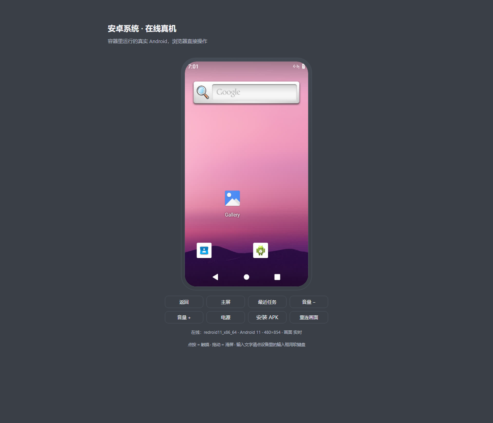
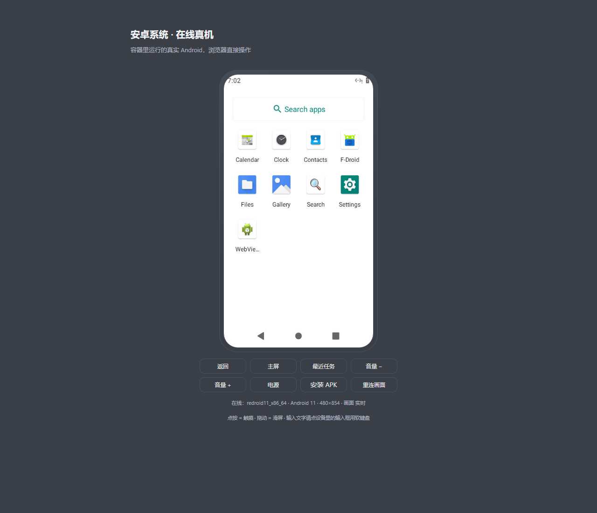
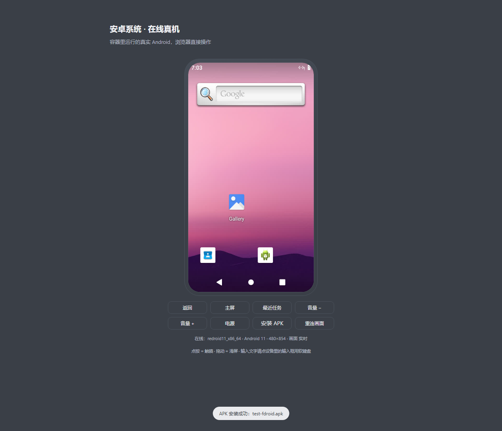
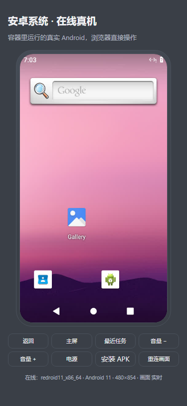

# android-box · 在线真安卓

> 容器里跑的**真实 Android**（AOSP Android 11，x86_64）：浏览器看实时画面、直接点按操作、上传安装 APK。
> 不是界面模拟，所有操作都注入真正的 Android 系统。

`Python 3.12 标准库` · `零第三方依赖` · `零构建` · `Android 11 / x86_64` · `MIT License`

**在线地址：** <https://wkeeli.cn/android/>

> 这是原「安卓手机模拟器」的正式替代品：`/phone/` 已停用并 308 跳转到 `/android/`，
> 旧界面模拟器代码保留在 [wzqfwanj/phone-sim](https://github.com/wzqfwanj/phone-sim) 仓库。

站点由**全站 Basic Auth** 保护，访问时需使用站点账号 `wkeeli` 登录（密码由站点管理员维护，本仓库不含密码）。
应用内部没有独立登录页，认证完全由网关负责。

## 截图

| 桌面 | 实时画面 |
| --- | --- |
|  |  |

| 安装 APK | 375px 移动端 |
| --- | --- |
|  |  |

## 能力

| 能力 | 说明 |
| --- | --- |
| 实时画面 | 容器内 Android 屏幕经 `adb screenrecord`（H.264）→ `ffmpeg` 转 MJPEG → 浏览器 `` 实时显示；`screenrecord` 不可用时自动降级为逐帧 `screencap` |
| 触摸操作 | 点按 = 设备触摸，拖动 = 滑屏；浏览器坐标按设备分辨率换算后经 `adb shell input` 注入真实系统 |
| 按键控制 | 返回 / 主屏 / 最近任务 / 音量 − / 音量 + / 电源（`adb shell input keyevent`） |
| 上传装 APK | 页面选择 APK 上传（上限 500MB），后端 `adb install -r -g` 安装，页面显示上传进度与安装结果 |
| 多端观看 | 多个浏览器连接共享同一路 MJPEG 流，服务端只采集一份画面，慢客户端自动丢帧 |
| 状态与重连 | `/api/state` 轮询显示 adb 在线、Android 是否启动完成、画面模式；画面断开自动重连 |
| 响应式 | 桌面端居中呈现手机外壳；375px 宽下无横向滚动 |
| 零外链 | 页面不请求任何 CDN、第三方脚本、网络字体或外部图片；画面为同源 MJPEG |

## 技术栈

| 层 | 选型 | 说明 |
| --- | --- | --- |
| 设备 | redroid（AOSP Android 11，x86_64） | Docker 容器里运行的真实 Android，`--privileged` + binderfs |
| 后端 | Python 3.12 标准库 | `http.server` + `threading` + `subprocess`，单文件 `app.py`，无第三方依赖、无需 pip |
| 画面 | `adb` + `ffmpeg` | `adb exec-out screenrecord`(H.264) → `ffmpeg` 转 MJPEG → `multipart/x-mixed-replace` 流；异常时降级逐帧截图 |
| 输入 | `adb shell input` | `tap` / `swipe` / `keyevent` / `text` 注入真实 Android |
| 前端 | 原生 HTML + CSS + JavaScript | 零依赖、零构建，无框架、无 CDN、无网络字体 |
| 部署 | systemd + Docker + Caddy | `redroid.service` 管容器、`android-box.service` 管 Web 服务；Caddy 子路径反代并关闭响应缓冲 |

## 目录结构

```
android-box/
├── app.py                    # 后端：Python 标准库单文件（HTTP + MJPEG + adb 注入 + APK 安装）
├── index.html                # 页面骨架：手机外壳 / 画面 / 工具栏 / 状态
├── style.css                 # 灰阶单主题样式，仅使用 :root 中 5 个变量
├── app.js                    # 前端交互（原生 JS，无框架）
├── favicon.svg               # 站点图标（本地 SVG，无外链）
├── tests/
│   └── test_app.py           # HTTP 层黑盒测试（unittest，adb/ffmpeg 用假命令）
├── deploy/
│   ├── redroid.service       # 容器单元：binder 加载/挂载 + docker run + 内存/端口限制
│   ├── android-box.service   # Web 服务单元：用户、环境文件、StateDirectory、HOME/TMPDIR、加固
│   ├── caddy-android.conf    # 网关 Caddyfile 片段（/android/ 子路径反代 + flush_interval -1）
│   ├── DEPLOY.md             # 完整部署手册（镜像导入、binder、验证、排错、持久化）
│   └── deploy.sh             # 本地一键发布脚本（git archive + scp）
├── docs/
│   └── screenshots/          # README 截图
│       ├── home.png
│       ├── stream.png
│       ├── install.png
│       └── mobile.png
├── README.md
├── LICENSE
├── .gitignore
└── .gitattributes
```

## 接口

| 方法 | 路径 | 说明 |
| --- | --- | --- |
| GET | `/` | 返回 `index.html` 页面 |
| GET | `/style.css` | 样式表 |
| GET | `/app.js` | 前端脚本 |
| GET | `/favicon.svg` | 站点图标 |
| GET | `/stream.mjpg` | 实时画面：`multipart/x-mixed-replace; boundary=frame` 长连接，每帧一张 JPEG |
| GET | `/api/health` | 健康检查，返回服务名、时间与运行时长 |
| GET | `/api/state` | 设备与画面状态：`adb_online`、`serial`、`model`、`android`、`sdk`、`resolution`、`booted`、`stream`（含 `mode` / `error`） |
| GET | `/api/apps` | 已安装的第三方应用包名列表 |
| POST | `/api/input` | 输入注入（JSON），`type` 为 `tap` / `swipe` / `key` / `text` |
| POST | `/api/install` | 请求体为 APK 二进制（上限 500MB），后端执行 `adb install -r -g` |

输入接口请求体示例：

```json
{"type": "tap", "x": 360, "y": 640}
{"type": "swipe", "x1": 360, "y1": 900, "x2": 360, "y2": 300, "duration": 200}
{"type": "key", "key": "HOME"}
{"type": "text", "text": "hello"}
```

`key` 支持：`BACK` / `HOME` / `APP_SWITCH` / `POWER` / `VOLUME_UP` / `VOLUME_DOWN` / `ENTER` / `MENU`；
`text` 仅支持 ASCII（中文请用设备软键盘）。

## 环境变量

| 变量 | 默认值 | 说明 |
| --- | --- | --- |
| `HOST` | `0.0.0.0` | 监听地址（本机调试建议 `127.0.0.1`） |
| `PORT` | `8150` | 监听端口 |
| `ADB_SERIAL` | `127.0.0.1:5555` | adb 设备串号（redroid 容器地址；本机真机/模拟器改成实际串号） |
| `STREAM_W` | `480` | 推流最大宽度（越小越省 CPU；默认与设备宽度一致） |
| `STREAM_FPS` | `8` | 兜底逐帧截图模式的帧率上限（screenrecord 正常时按实际画面变化出帧） |
| `STREAM_Q` | `7` | MJPEG 质量（2~31，越小越清晰、越费 CPU/带宽） |
| `APP_TZ` | `Asia/Shanghai` | 日志与接口时间时区 |
| `ADB_BIN` | `adb` | adb 可执行文件路径（可选） |
| `FFMPEG_BIN` | `ffmpeg` | ffmpeg 可执行文件路径（可选） |

## 本地运行

需要本机有可用的 Android 设备（真机、模拟器，或本机跑的 redroid 容器），并已安装 `adb` 与 `ffmpeg`。

```bash
git clone https://github.com/wzqfwanj/android-box.git
cd android-box
python app.py
```

然后浏览器打开 <http://127.0.0.1:8150> 。若 `adb` 未连上，页面会提示正在等待设备，连上后自动恢复画面。

按设备调整串号或推流参数：

```bash
ADB_SERIAL=127.0.0.1:5555 STREAM_W=480 STREAM_FPS=8 python app.py
# 真机/官方模拟器示例：
ADB_SERIAL=emulator-5554 python app.py
ADB_SERIAL=<真机序列号> python app.py
```

## 测试

后端测试不依赖真实 adb/ffmpeg（测试里把这两个命令指向不存在的路径，验证接口优雅降级）：

```bash
python -m unittest discover -s tests -v
```

## 部署

生产部署由两部分组成：应用机用系统 Docker 跑 redroid 容器，`systemd` 常驻 `android-box`
Web 服务；网关机用 Caddy 把 `https://wkeeli.cn/android/` 反向代理到应用机 `8150` 端口。

完整步骤（镜像离线导入、binder 持久化、systemd 单元、Caddy 路由、线上验证、日志排错、
升级、容器数据持久化、常见问题）见 **[deploy/DEPLOY.md](deploy/DEPLOY.md)**。

| 文件 | 用途 |
| --- | --- |
| [deploy/redroid.service](deploy/redroid.service) | 容器单元：binder 驱动加载与 binderfs 挂载、`docker run`、内存与端口限制 |
| [deploy/android-box.service](deploy/android-box.service) | Web 服务单元：`androidbox` 用户、`/etc/android-box.env`、`StateDirectory`、`HOME`/`TMPDIR`、基础加固 |
| [deploy/caddy-android.conf](deploy/caddy-android.conf) | 网关机 Caddyfile 片段：`redir` + `handle_path /android/*` + `flush_interval -1` |
| [deploy/DEPLOY.md](deploy/DEPLOY.md) | 完整部署手册 |
| [deploy/deploy.sh](deploy/deploy.sh) | 本地一键发布：git push（失败重试 3 次）→ git archive 打包 → scp 到应用机解压重启 → 网关探测 `/android/` |

一键发布（本地 Windows Git Bash，需先完成 DEPLOY.md 的一次性部署）：

```bash
bash deploy/deploy.sh
```

> 应用机无法访问 GitHub，因此代码由部署机本地 `git archive` 打包后 scp 同步；
> 应用机上的 `/opt/android-box` 是普通目录，不是 git 仓库。

## 限制与边界

- **指令集**：容器是 x86_64 Android。**仅支持 ARM 的 APK 装不上**（`INSTALL_FAILED_NO_MATCHING_ABIS`），
  需要 x86_64 或包含 x86_64 的 universal APK。
- **性能**：应用机为 2 vCPU / 3.4GB，默认约 **8fps**、触摸为**百毫秒级延迟**；
  画面参数（`STREAM_W` / `STREAM_FPS` / `STREAM_Q`）可在 `/etc/android-box.env` 调整。
- **系统镜像**：AOSP Android 11，**没有 GApps / Google Play 服务**，依赖 Google 服务的应用无法使用。
- **音频**：只传输画面，**没有声音**。
- **单设备单实例**：一个 redroid 容器、一个 `ADB_SERIAL`；多人同时打开会看到同一画面并共享操作。
- **容器数据**：容器以 `--rm` 运行，重启容器/机器会得到全新 Android，**已安装的应用会丢失**；
  如需保留见 DEPLOY.md 第 10 节（挂载 `/data`，默认不启用）。
- **文字输入**：`adb input text` 只支持 ASCII，中文等需用设备软键盘输入。
- **上传上限**：单个 APK 最大 500MB。
- **访问控制**：公网访问受全站 Basic Auth 保护，登录后即可查看与操作；请勿把 5555/8150 直接暴露公网。

## 开发约束符合性

- **灰阶单主题**：`:root` 只定义 `--bg`、`--fg`、`--muted`、`--line`、`--hover` 五个变量；
  无浅色/深色切换，无主题切换按钮。
- **零依赖、零构建、零外链**：后端仅用 Python 标准库（无需 pip），外部命令只有系统级 `adb` 与 `ffmpeg`；
  前端原生 HTML/CSS/JS（无包管理器、无打包步骤）；页面不引用任何 CDN、第三方脚本、网络字体或外部图片，
  实时画面是**同源** ``。
- **JavaScript 的使用理由**：实时画面挂载与断流重连、把点按/拖动换算成设备坐标、按键注入、
  APK 上传进度、设备状态轮询都需要交互与状态管理，纯 HTML/CSS 无法完成，
  因此引入一份原生 `app.js`；不使用任何框架。
- **响应式**：桌面端居中呈现手机外壳；375px 宽下无横向滚动。
- **标题与介绍**：浏览器 `<title>` 与页面 `<h1>` 均为「安卓系统 · 在线真机」；
  页面 `.sub` 用一句话说明定位（容器里运行的真实 Android）。
- **无应用内登录**：认证由网关 Caddy 的全站 Basic Auth 统一负责，应用内不实现登录。

## 许可证

[MIT License](LICENSE) © 2026 wzqfwanj
